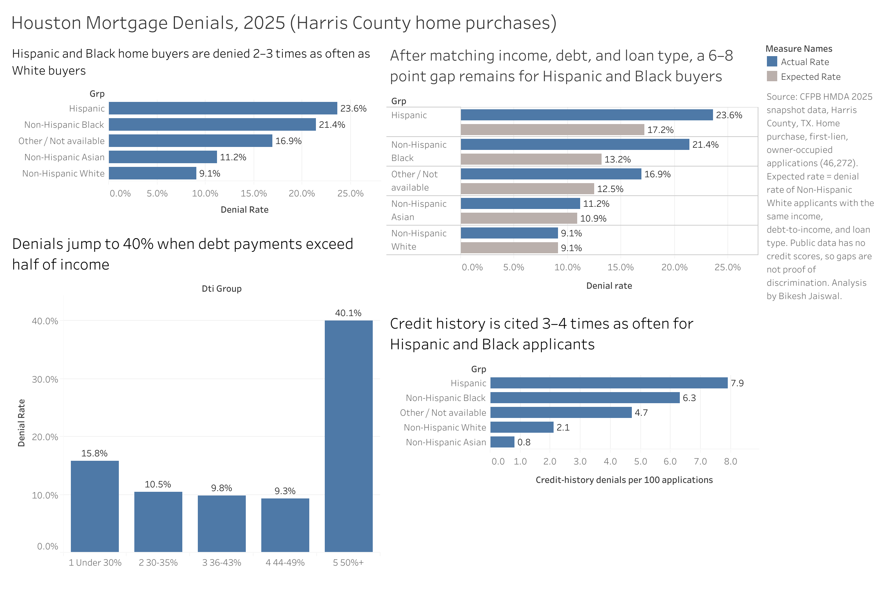

# Houston Mortgage Denials (2025)

**Are some groups of Harris County home buyers denied mortgages more often than others, and how much of that gap remains when income, debt, and loan type are similar?**

**[View the interactive dashboard on Tableau Public](https://public.tableau.com/app/profile/bikesh.jaiswal/viz/HoustonMortgageDenials/Dashboard1)**

---

## Key findings

- **Raw gap:** Hispanic (23.6%) and Non-Hispanic Black (21.4%) home buyers were denied 2–3 times as often as Non-Hispanic White buyers (9.1%).
- **After matching:** when each group is compared with White applicants of the same income group, debt-to-income (DTI) group, and loan type, a gap of about **6 points remains for Hispanic** applicants and **8 points for Black** applicants. The gap for Asian applicants nearly disappears (0.3 points).
- **Debt is a cliff, not a slope:** denial rates stay near 10% from 30% to 49% DTI, then jump to **40%** once debt payments exceed half of income.
- **Credit history is the likely missing piece:** lenders cited credit history **3–4 times as often** for Hispanic (7.9 per 100 applications) and Black (6.3) applicants as for White applicants (2.1). Credit scores are not in public data, so this part of the gap can't be tested directly.
- **Race alone hides the biggest gap:** most Hispanic applicants are recorded as "White" by race. Combining race and ethnicity was needed to see the Hispanic gap at all.

| Group | Applications | Actual denial rate | Expected rate* | Unexplained gap |
| --- | --- | --- | --- | --- |
| Hispanic | 16,778 | 23.6% | 17.2% | 6.4 pts |
| Non-Hispanic Black | 5,788 | 21.4% | 13.2% | 8.2 pts |
| Other / Not available | 6,712 | 16.9% | 12.5% | 4.3 pts |
| Non-Hispanic Asian | 3,973 | 11.2% | 10.9% | 0.3 pts |
| Non-Hispanic White | 13,007 | 9.1% | 9.1% | comparison group |

*Expected rate = the denial rate of Non-Hispanic White applicants in the same income group, DTI group, and loan type.

## What this means

- Debt-to-income explains a large part of who gets denied. Helping buyers lower DTI below 50% before applying would likely reduce denials more than anything else in this data.
- The remaining 6–8 point gap is not explained by income, debt, or loan type. It deserves a closer review with data the public file doesn't include (credit scores, savings, employment history).

## How adding factors changed the gap

| Group | Matched on income + DTI | + loan type |
| --- | --- | --- |
| Hispanic | 6.8 pts | 6.4 pts |
| Non-Hispanic Black | 6.7 pts | 8.2 pts |
| Non-Hispanic Asian | 1.3 pts | 0.3 pts |

Adding loan type made the Black gap **bigger**, not smaller. Nearly half of Black applicants (47.6%) used FHA loans, which are denied less often than conventional loans (15.3% vs. 18.7%). Comparing like with like revealed more of the gap instead of explaining it away.

## Data

- **Source:** [CFPB HMDA Data Browser](https://ffiec.cfpb.gov/data-browser/), 2025 snapshot, Harris County, TX (county 48201)
- **Downloaded:** applications with a decision (action taken 1, 2, 3)

## Method (SQL in DuckDB, inside Google Colab)

**Cleaning log**

| Step | Rows |
| --- | --- |
| Downloaded (decisions only) | 90,751 |
| Home purchases only (`loan_purpose = 1`) | 54,854 |
| + first lien, owner-occupied | 46,961 |
| + valid positive income | 46,272 |

Why home purchases only: denial rates vary a lot by loan purpose (17.5% for home purchases vs. about 54% for home improvement).

**Steps**
1. Built clean tables step by step (`apps` → `apps2` → `apps3` → `apps4`) with `CREATE TABLE ... AS SELECT`
2. Combined race and ethnicity into one group column with `CASE WHEN` (Hispanic of any race first)
3. Grouped messy DTI text values (`"<20%"`, `"36"`, `"50%-60%"`, ...) into 5 buckets plus Missing
4. Converted income from text with `TRY_CAST` and grouped it into 4 income bands
5. Calculated expected rates with a CTE and a `JOIN` on income × DTI × loan type, weighting each cell by its number of applications
6. Counted denial reasons by group with a window function (`SUM(COUNT(*)) OVER (PARTITION BY grp)`)
7. Exported result tables with `COPY ... TO` for Tableau

## Limits

- **No credit scores, savings, or job history** in public HMDA data, so an unexplained gap is not proof of discrimination.
- **19% of applications had no race recorded**, and they were denied more often (25.9%). Results for known groups may not represent everyone.
- **Denial reasons are reported by lenders**, so they show what lenders said, not proof of what drove the decision.
- **2025 only** (snapshot data). Year-to-year trends are not included.
- **Only people who applied** are in the data. People who never applied, or were discouraged early, are not.
- 14 applications (0.03%) were dropped from the matched comparison because no White applicants shared their income × DTI × loan type group.

## Files

| File | What it is |
| --- | --- |
| `mortgage_denial.ipynb` | Full analysis (SQL in DuckDB, Google Colab) |
| `result_group_rates.csv` | Raw denial rate by group |
| `result_adjusted_gap.csv` | Actual vs. expected rate and unexplained gap |
| `result_dti_rates.csv` | Denial rate by DTI group |
| `result_credit_history.csv` | Credit-history denials per 100 applications |
| `dashboard.png` | Dashboard screenshot |

## Tools

SQL (DuckDB) · Python (pandas) · Google Colab · Tableau Public

## Author

**Bikesh Jaiswal**, BBA in Management Information Systems, University of Houston-Downtown (May 2027)
